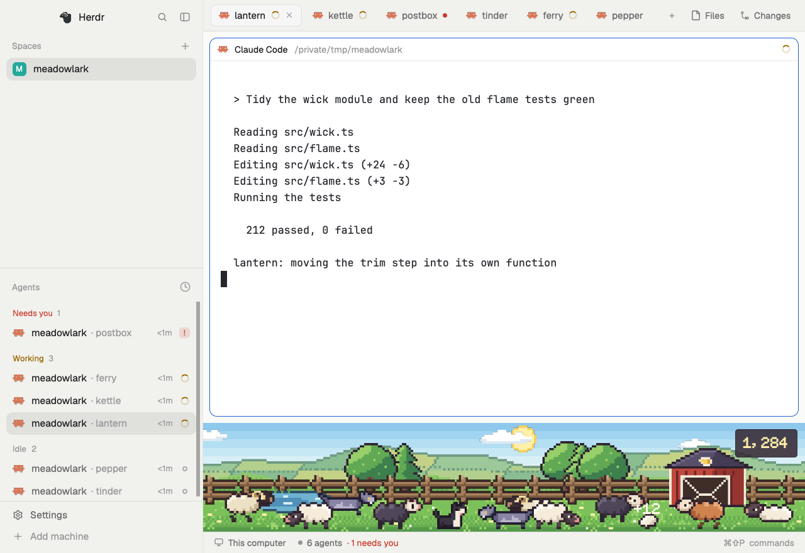

# Woolhill

An idle game for Herdr. Your agents are a flock on a hillside along the bottom of the window. Working sheep graze and walk, idle ones rest, and finished ones hop and drop wool. A blocked agent draws a wolf. Spend the wool on the hill.

A mod for the [Herdr](https://github.com/ogulcancelik/herdr) desktop app, with art drawn pixel by pixel in this repo. It runs on the mod API alone, with no helper program, and was run in real Herdr 0.1.13 windows on Windows and on a Mac, at zooms from 1.0 to 1.5. It hasn't been run on Linux.

Ask your agent to add it from [herdr.dev/mods](https://herdr.dev/gallery/?type=mods), or point it at this repo. It reads [the recipe](RECIPE.md) and every file first. By hand, copy `mods/woolhill` into `~/.config/herdr-app/mods`, merge `keys.json` into yours and restart Herdr so the pixel font loads. `ctrl-shift-h` opens the overlay. The overlay has **Pin to bottom strip**, which puts the hill under the terminals at 144px, and then reads **Unpin from bottom strip**, which hides it again. It reads the shown layout each time, so it's right after a hide from anywhere else. Herdr doesn't add a new mod to a shipped layout and won't take new blocks there, so on `main`, `terminals` and `win98` the button only shows if the layout already has the block. Duplicate the layout first to pin it there.

## How it plays

- One sheep per agent. Press a sheep or a wolf to jump to its agent.
- Wool comes from finished turns, and more for longer runs. A 1 minute turn pays 3, 25 minutes pays 11, and no turn pays more than 40. Time spent blocked doesn't count.
- The longer an agent waits, the closer its wolf comes. It stops short of the sheep, and answering drives it off. No sheep is ever lost and no wool is ever taken.
- The sky follows your clock. Turns are only counted while the strip is in the shown layout.

## What it touches

Progress is in Herdr's shared state on this machine. It reads agent status, never terminal text. It runs one program, only when you open Share: `certutil` on Windows, `base64` on macOS and Linux, to turn the card into a PNG. It makes no network calls unless a leaderboard is set up.

The flock card and the line you can copy hold game numbers only, never a project, folder or agent name. Save card writes to `~/Downloads`.

## Leaderboard

Off, and hidden, until someone sets one up. `leaderboard/` is a small Cloudflare Worker with a tested handler. To run your own, deploy it with your own KV namespace and put its address in `LEADERBOARD_URL` in `mods/woolhill/config.js`. The Board page then shows, and it stays off until each person turns it on. It sends only a nickname of their choosing and four game numbers: lifetime wool, wolves driven off, longest run and most sheep at once.

**Scores can be faked.** There are no accounts, and nothing checks a score. Anyone can post any number under any nickname, including one somebody else uses. Treat it as a bit of fun. The Worker has no rate limit of its own, so add one in Cloudflare if yours gets busy.

## For screenshots

Set `"props": { "demo": true }` on the `woolhill` block in your layout. It shows every state at once with made-up agents and a made-up save, needs no agents and saves nothing. Add `"hour": 22` to fix the time and `"season": "winter"` to pick a season.

## Building

`node art/build.mjs` writes everything in `mods/woolhill/art`, the font and `cardart.js` from the sprites in `art/`. `node --test` runs the tests. Neither needs anything but Node.

MIT, see `LICENSE`.
