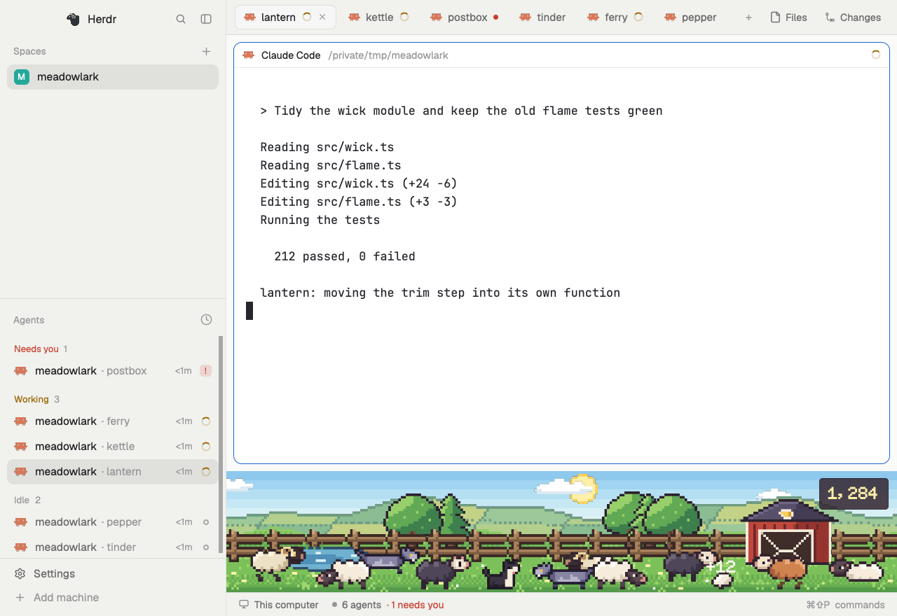

# Woolhill

An idle game along the bottom of the window. Your agents are a flock on a pixel-art hillside, drawn from live agent state. Working sheep graze and walk, idle ones rest, and a finished one hops and drops wool. A blocked agent draws a wolf toward its sheep, closer the longer it waits, and answering drives it off. No sheep is ever lost. Wool buys fences, trees, a pond, a dog, a barn, breeds of sheep and seasons, and the sky follows the real clock.

## What you see

**The strip**, 144px tall by default, full width, under the terminals. All art is drawn at 3 logical pixels to an art pixel, 48 art rows tall. It anchors to the bottom, so a taller block shows more sky and a shorter one crops it. Back to front:

- **Sky:** six flat bands from the top to row 22, a hard step between each, from a table of look (light or dark theme) by phase. Dawn is 05:00 to 08:00, day 08:00 to 17:00, dusk 17:00 to 20:00, night otherwise. Day in the light look runs `#8ec8ec` to `#e6f4f4`, and in the dark look `#1f3a52` to `#5c8590`.
- **Stars** at night, a 240 by 36 tile. The **sun or moon**, 36px, across its arc by the clock. Three **clouds** that drift with the clock, dimmed at night and in the dark look.
- **Hills:** one seamless 256 by 48 tile for each season and look: a far slope of walled fields, a nearer rise and the grass.
- **Bought things:** trees and pines on the rise, fence, barn, pond.
- **Actors**, in three lanes with feet at rows 41, 44 and 47, back lanes first: sheep 72 by 45, wolves 84 by 42, the dog 48 by 39, tufts of wool 27 by 21.
- **Shade:** one flat colour over the hill at dawn, dusk and night. Nothing at day.
- **The loft** of the barn, a `#fff0a8` window with a faint halo, over the shade from dusk on.
- **The sign:** top right, 10px in, `#33242fd8`, radius 4, the wool to spend in `#fff0a8`, 16px pixel font.

**The overlay**, 860 by 640 on `popover`, 18px padding. A header holds the name in 24px pixel font, a `Demo data` tag in demo mode, the pages as 30px tabs, and at the right a tuft and the wool. If the shown layout has no strip, a button reads `Add the hill to this window`.

- **Shop:** Hill, Sheep and Seasons, in cards 196 by 66 on `canvas`, a picture beside the name and either `Owned` or a `solid` button reading `Buy 150`, dim if it costs too much. A later tier shows once the one before it is owned. An owned season has `Use`, and the one on has an `accent` border and reads `In use`.
- **Flock:** lifetime wool and wool to spend in 40px amber pixel font, then wolves driven off, longest run, turns finished and most sheep at once in 24px, then the hill as bought with one sheep of each breed.
- **Share:** the flock card at 640 by 335, the line to copy under it, then `Save card` and `Copy line`.
- **Board:** only with a leaderboard set up, or in demo mode. `Share my score: Off`, a nickname field, `Send`, and rows of rank, nickname, wool, wolves and longest run. Your own row is on `selected`.

A note under the page, 12px `muted`, or `blocked` if something failed. Colours in the overlay are theme names, except wool's amber, `#f2b950` on dark and `#a86a10` on light.

**The flock card**, 1200 by 628, drawn at 300 by 157 and scaled by 4. On `#15111c`: the name at twice size, `For Herdr` at the right, a rule, `Lifetime wool` and the number at four times size in `#f2b950`, four tiles for wolves, longest run, turns and most at once, then the hill along the bottom with the things bought and up to seven sheep. In demo mode the corner reads `Sample flock`.

## How it behaves

- **working:** walks to a spot 40 to 170px away at 20px a second, then grazes for 8 to 22 seconds.
- **idle:** lies down. After 5 minutes it sleeps, eyes closed.
- **done:** treated as idle. Herdr turns it into idle once the person looks.
- **blocked:** stops, looks up and turns to face its wolf.
- **A finished turn** is working or blocked going to done or idle. The sheep hops 20px once, a tuft drops with `+N` over it, the label goes after 3 seconds and the tuft after 14.
- **Wool:** `1 + floor(2 * sqrt(minutes))`, at most 40. Time blocked isn't counted.
- **A wolf** comes in from the side with more room and is drawn once at the edge before it sets off. It stands 190px from the sheep at first, then 150 after a minute, 118 after 3, 92 after 6 and 72 after 10, and stays there. It only moves when that distance changes. It has its sheep's lane.
- **Answering:** the wolf turns and runs off the edge at 240px a second, and wolves driven off goes up by one. A block under 3 seconds doesn't count, and neither does an agent that closes, though its wolf still leaves.
- **The dog**, once bought, sits at the right, and trots to stand by a sheep with a wolf.
- **Press** a sheep or a wolf to jump to its agent. Hover shows its tab's name, or its space's if nobody named the tab. Press the sign to open the overlay.
- **Breeds:** cream comes with the hill. Each sheep's breed comes from a hash of its address over the breeds owned, so buying one turns part of the flock.
- **Keys:** `ctrl-shift-h` opens and closes the overlay. `woolhill.shop`, `.flock`, `.share`, `.board`, `.save`, `.copy` and `.place` can be bound, and reach the open overlay. Esc closes it.
- **After a restart:** a run still open counts only if its agent is still at it, because nobody saw when it stopped.
- **Leaderboard:** with `LEADERBOARD_URL` empty the page doesn't exist. With it set, nothing is read or sent until the person turns it on. A score goes only after they pick a nickname and press `Send`.

## Built from

- **One mod, two roles.** `mods/woolhill`, with `{ "place": "bottom", "size": 144, "title": "Woolhill", "overlay": { "width": 860, "height": 640 } }`. A copy with `props().overlay` is the overlay and only the strip earns.
- **The block:** `{ "id": "woolhill", "type": "block", "size": { "px": 144 }, "min": 96, "max": 320, "content": { "mod": "woolhill" } }`, in the column that holds the terminals, right after the child holding the `tab` block. Props: `demo`, `hour`, `season`.
- **Files:** `game.js` rules, shop and save. `flock.js` who is where, as a start, a target and a length. `world.js` sky and placing. `scene.js` the strip. `shop.js` the overlay. `card.js` the PNG. `board.js` and `config.js` the leaderboard client. `place.js` adding the block. `demo.js` made-up data. `cardart.js`, `art/` and `fonts/` are written by `art/build.mjs`.
- **`herdr`:** `agents()`, `shared` and `setShared` (`woolhill.state`, `woolhill.demo`), `run` (`pane.focus`, `agent.focus`, `mod.open`, `layout.clone`, `layout.set`), `layout()`, `settings().dark` and `.zoom`, `window().platform`, `nextCommand()`, `exec`, `closeOverlay`, `appHome()`, `home()`, `theme()`, `props()`. From `fs/promises`: `mkdir`, `writeFile`, `unlink`. `cx.write_to_clipboard` for the line, `fetch` for the board.
- **Motion:** `.transition("left")` with a linear length walks, `.transition("top")` hops, and animated GIFs from `image()` do the legs and the grazing. Those GIFs and transitions run in the app, not in the script.
- **Programs:** `certutil` on Windows, `base64` on macOS, `sh` with `base64` elsewhere. Only for the card.
- **Art:** made in the repo. `art/sprites.mjs` holds every sprite as text, one character a pixel, with sheep and wolves stamped from parts so frames match. `art/hills.mjs` draws the hills, `art/font.mjs` turns the bitmap font into a TrueType file, and `art/encode.mjs` writes PNG and GIF. Generated art wasn't used.
- **`leaderboard/`:** a Cloudflare Worker, one KV key, `POST /score` and `GET /top`, keeping each nickname's best.

## Watch out

- **Herdr 0.1.13 didn't dock this mod.** With `"place": "bottom"` it started and opened as an overlay, but no block appeared in a shipped layout, and shipped layouts can't take structure. So the overlay offers the button, which clones a shipped layout, adds the block and calls `layout.set`. An agent adding this mod can do the same by hand. Earlier reports had the app dock a bottom mod as a right-hand column when the root is a row.
- **`fs.writeFile` with a Uint8Array writes an empty file and reports success** on Herdr 0.1.13 on Windows, even with bytes from `fs.readFile`. A string works, and writes are refused outside the app's folder. So the card is written as base64 text and `certutil` or `base64` makes the PNG, straight into `data/woolhill` or `~/Downloads`. Check a file's size, not that the call passed.
- **Zoom.** `on_size_change` reports window pixels, while `.w()`, `.left()` and text are the app's own, scaled by `settings().zoom`. So the strip keeps the size as reported and divides by the zoom when it draws, and a zoom change needs no new report. Without that, at Herdr's default of 1.2 the hill falls off the bottom and the flock walks off the right. When the width shrinks, whatever is past the edge comes back to it.
- **The overlay can't fit itself.** It's 860 by 640 in the app's units, so 1032 by 768 at zoom 1.2 and 1290 by 960 at 1.5. In a smaller window Herdr centres it and cuts it off, header and all. A mod can't read the window's size and `mod.open` takes none. Esc still closes it, and the `woolhill.*` keys still change page.
- **Files stored at 1x blur.** `image()` scales smoothly, so art is written at 6 pixels to an art pixel: an exact halving at 1x and one to one at 2x.
- **The engine is slow,** about 140 ns for one loop step, and a task is stopped at about 55 ms. The card is 118 small steps with `cx.sleep(1)` between, and the slowest took 25 ms on a Ryzen 5 1600. Every step can run twice safely. Going back to Share after 8 seconds starts a stuck card again.
- **Don't render on a timer.** The tick is 2 seconds while anything will change and 10 seconds otherwise, and it only calls `cx.notify()` if something did. A status change the app renders for gets a tick straight away, so a short turn still pays. A walk lasts whole ticks, so the legs stop with the sheep. With every agent idle there are no renders at all. Measured: a render takes about 2 ms, at most 4 ms, and four working agents cause about one every 5 seconds.
- **An idle sheep is a still PNG on purpose.** A GIF makes the app redraw while it shows.
- **A wolf must be drawn once at the edge.** If it gets its target in the step it's made, it appears on the hill with no walk in.
- **The app keeps an image it has loaded,** so each card has new file names, the last one is deleted, and the card goes when the overlay closes.
- **The font loads at start,** so a fresh install needs a restart for it. Text is sharpest at multiples of 8. It has capitals only, and lower case maps to them.
- **A sheep's id must be stable,** so `.transition` has something to move from. It uses the terminal's address.
- **Earning needs the strip:** turns aren't counted while it isn't in the shown layout.
- **Limits:** three lanes, and past about one sheep per 80px they crowd. Scores can be faked. The Worker has no rate limit, and two posts at once can lose one.

## Done when

- `herdr-app check mods/woolhill` passes, and `node --test` passes.
- At zooms 1.0, 1.1, 1.2 and 1.5 the strip fills its block, with the hill on the floor and the sign inside the window.
- In `main`, the overlay's button makes `main-woolhill` with the block between the terminals and the status bar.
- With demo props, the strip shows walking, grazing, alert, sleeping, resting and hopping sheep, a standing wolf and a walking one, a tuft, the dog and everything bought, and nothing is written to `woolhill.state`.
- With a stand-in agent reporting OSC 7501 `state=working:app=claude-code`, a sheep appears. `blocked` brings a wolf. `working` sends it off and adds one to wolves driven off. `idle` pays wool.
- Buying takes wool and the thing appears on the hill. The save survives a restart.
- Share shows the card, Save card makes a real 1200 by 628 PNG in `~/Downloads`, and neither it nor the copied line holds a project name.
- `LEADERBOARD_URL` empty means no Board tab and no network.
